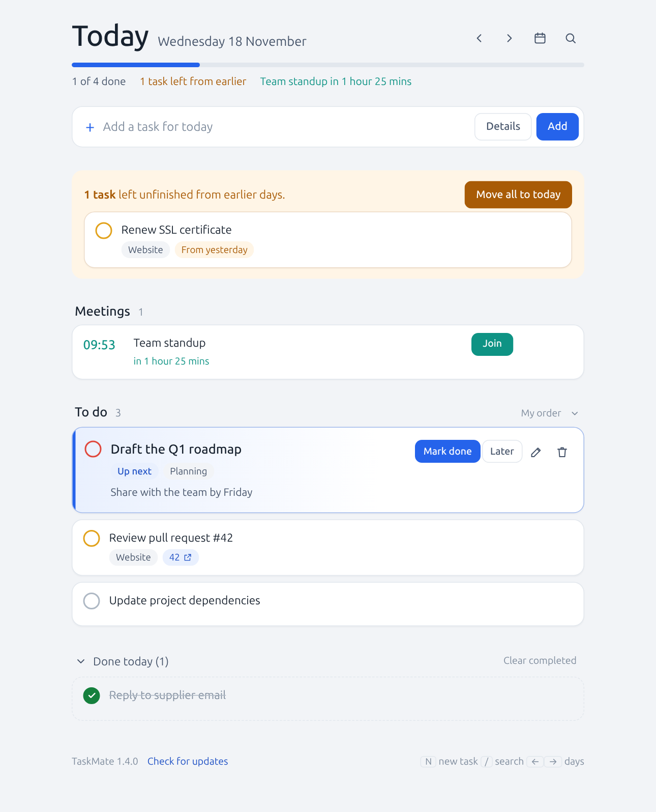
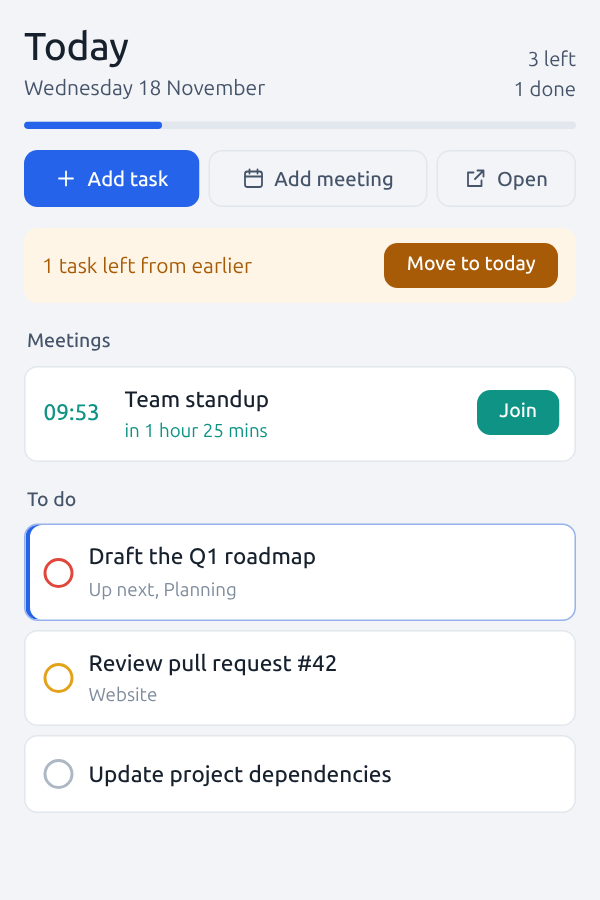
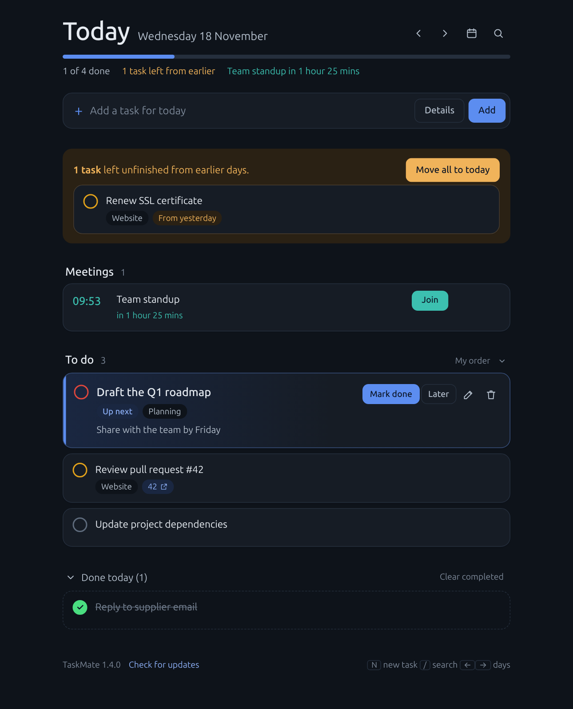

# TaskMate

A calm, fast daily planner for Ubuntu. TaskMate keeps today's tasks and meetings in the top bar, reminds you before meetings start, and carries unfinished work forward so nothing slips.

It runs entirely on your own computer. No account, no cloud, no tracking.



## Features

**Plan the day**
- Day view with a progress bar, plus quick navigation to yesterday, tomorrow or any date
- "Up next" highlights the task to do now; drag tasks to reorder them
- Unfinished tasks from earlier days are collected in one place, ready to move to today
- Priorities shown as coloured checkboxes: red for high, amber for medium, grey for low
- Projects, rich-text notes, and links that show as compact chips (for example a ticket number)

**Never miss a meeting**
- Meetings with a start time and a join link
- Desktop notifications 10 minutes before and at the start time, with a Join button
- Countdowns such as "in 1 hour 25 mins" in the app and the top bar

**Fast to use**
- Quick add that understands plain text: `Send the invoice tomorrow #Accounts !high`
- Undo for done, move and delete, instead of confirmation pop-ups
- Keyboard shortcuts throughout, and a quick panel on **Windows key + Shift + T**

**Built for the desktop**
- Top-bar icon with today's count and the next meeting
- Its own app window and app-grid icon, in light and dark mode
- Optional access from your phone on the same Wi-Fi, protected by a private key
- Updates itself from GitHub Releases

<p>
  
  &nbsp;
  
</p>

## Requirements

- Ubuntu 22.04 or later with the GNOME desktop (other GNOME-based distributions should work)
- Python 3 (included with Ubuntu)
- The installer adds two small system packages if they are missing: `gir1.2-ayatanaappindicator3-0.1` for the top-bar icon and `gir1.2-webkit2-4.1` for the app window. This asks for your password once.

## Install

```bash
curl -sL https://github.com/asanka-J/Task-master/releases/latest/download/taskmate.tar.gz | tar xz
cd taskmate && bash install.sh
```

TaskMate starts straight away and every time you log in. Open it from the app grid, the top-bar icon, or the quick panel.

## Using TaskMate

### Quick add

Type a task in the "Add a task" bar and press Enter. Add any of these to fill in the details as you type:

| Write | Result |
|---|---|
| `#Website` | Puts the task in the Website project |
| `!high`, `!low` | Sets the priority (medium is the default) |
| `today`, `tomorrow` | Sets the day |
| `@14:30`, `@2:30pm` | Makes it a meeting at that time |

Choose **Details** for the date picker, notes and meeting link.

### Keyboard shortcuts

| Keys | Action |
|---|---|
| Windows key + Shift + T | Open or close the quick panel (works anywhere) |
| `N` | New task |
| `/` | Search all tasks and notes |
| `←` `→` | Previous or next day |
| `T` | Back to today |
| `Esc` | Cancel editing, close the panel |

### Top bar

The icon shows how many tasks are left today and the next meeting. Its menu lists today's meetings and tasks, each with Mark as Done, Move to Tomorrow, Edit and Delete. Choose **Show Panel** or middle-click the icon to open the quick panel.

### Phone access

TaskMate only accepts connections from your own computer by default. To use it from your phone on the same Wi-Fi:

```bash
bash install.sh --lan
```

The installer prints a private link. Open it once on your phone and it stays signed in. Keep the link to yourself. To turn phone access off again:

```bash
bash install.sh --local
```

## Updates

TaskMate checks for a new release shortly after you log in and every six hours. When one is available, choose **Update** in the top-bar menu or **Check for updates** at the bottom of the window. Your tasks are kept.

## Your data

- Tasks are stored in a single SQLite file: `~/.local/share/taskmate/tasks.db`. Back it up by copying that file.
- Settings live in `~/.config/taskmate/config`.
- Nothing is sent anywhere. The only outside connection is the update check to GitHub.

## Uninstall

```bash
bash ~/.local/share/taskmate/uninstall.sh           # keeps your tasks
bash ~/.local/share/taskmate/uninstall.sh --purge   # removes everything
```

## Development

TaskMate uses only the Python standard library, plain HTML/CSS/JavaScript, and the GTK libraries that ship with Ubuntu. There is no build step.

| File | Purpose |
|---|---|
| `taskmate.py` | Local web server, JSON API and SQLite storage (runs as a systemd user service) |
| `page.html` | The interface: main view and quick panel |
| `taskmate_indicator.py` | Top-bar icon, menu and meeting reminders |
| `taskmate_window.py` | App window and quick panel (WebKitGTK) |
| `taskmate_update.py` | Update check and install from GitHub Releases |
| `install.sh`, `uninstall.sh` | Installation, phone access and keyboard shortcut |

Run a copy against a throwaway database:

```bash
TASKMATE_DATA=/tmp/taskmate-dev python3 taskmate.py
# then open http://localhost:8765
```

### Releasing

Update `VERSION`, commit, then push a tag:

```bash
git tag v1.4.1 && git push origin v1.4.1
```

GitHub Actions builds `taskmate.tar.gz` and publishes the release. Installed copies offer the update automatically.

## Author

Created by **Asanka Jayasundara**.
